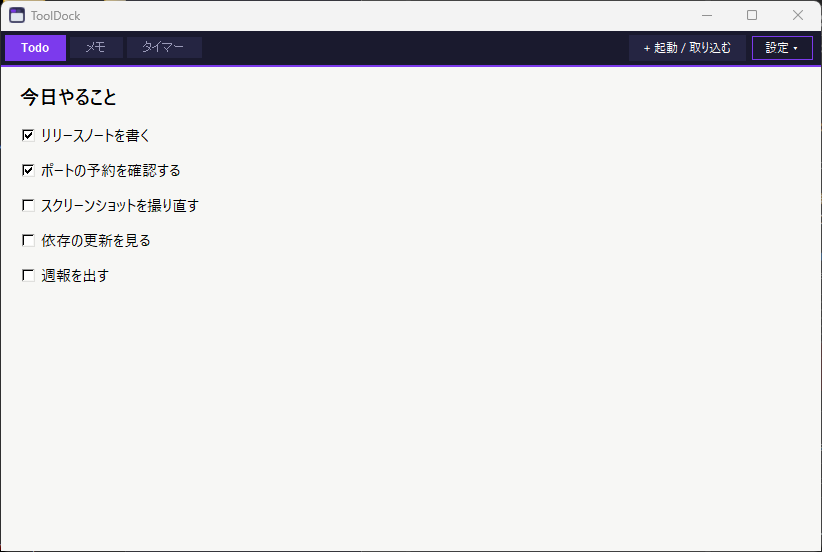

# ToolDock

別々に起動したツールの窓を、1 つの枠にタブでまとめる Windows 用のアプリです。
自作のツールを 1 つずつ起動していくと、タスクバーと窓がどんどん増えて散らかる、を減らすためのものです。



<sub>画面は架空のデモアプリを取り込んだものです。</sub>

- 相手のアプリには手を入れません。窓の枠 (タイトルバー) を外してドックの中に重ね、タブで切り替えます
- タスクバーにはドックのボタンが 1 つだけ残ります
- ドックから外したり、ドックを閉じたりすると、元の窓に戻ります

## ダウンロード

[Releases](https://github.com/lancard-aikawa/ToolDock/releases) の `ToolDock-<版>-win-x64.zip` を展開し、`ToolDock.exe` を起動します (Windows 10 / 11)。

1. `ToolDock.exe` の隣の `tooldock.toml` に、まとめたいツールを書きます (書き方は中の見本のとおり)
2. `ToolDock.exe` を起動し、右上の「+ 起動 / 取り込む」からツールを起動します

```toml
[[tool]]
name = "MyTool"
exe = "C:/Tools/MyTool/MyTool.exe"
```

- 署名の無い exe なので、初回に SmartScreen の警告が出ることがあります (「詳細情報」→「実行」)

## 使い方

- **+ 起動 / 取り込む**: 登録したツールを起動します。起動済みのものは「〇〇 に切り替え」になり、2 つ目は起動しません
  (2 つ目が要るときは一番下の「もう 1 つ起動」)。登録していない窓も「起動中の窓を取り込む」から取り込めます
- **自動取り込み**: 登録したツールは、エクスプローラーからダブルクリックするなど、ドックを通さずに起動しても自動でタブになります。
  ドックを開いたときにもう起動しているものも取り込みます。設定画面などの 2 つ目の窓やダイアログはタブにしません
- **タブの右クリック**: 「ドックから外す (窓は残す)」「ツールを閉じる」。中クリックでも閉じます
- ドックを動かす・大きさを変える・最小化すると、中のツールもついてきます。ツール単体の大きさは、ドックの枠で変えます

## 設定 (右上の「設定 ▾」)

| 項目 | 選べるもの |
|---|---|
| 起動時に開く | 前回開いていたもの (既定) / 選んだものだけ (ツールごとにチェック) / 何も開かない |
| 閉じるときのツール | ドックの × で、毎回たずねる (既定) / 一緒に閉じる / 元の窓に戻して残す |
| ログイン時に起動する | Windows にサインインしたときにドックを起動する (exe の場所を登録するので、移動したら入れ直す) |

- 「一緒に閉じる」では、ツールに × と同じ閉じる操作を送って 5 秒待ちます。保存の確認などで閉じなかったツールは、元の窓に戻して残します
- ドックの大きさ・位置は、次に開いたときに戻ります
- ここで選んだ内容と前回のタブは `%LOCALAPPDATA%\ToolDock\` に保存します。`tooldock.toml` は書き換えません

`tooldock.toml` の設定:

```toml
auto_adopt = true       # ドックの外で起動した登録済みのツールも自動でタブにする
restore_session = true  # 「起動時に開く」をまだ選んでいないときに、前回開いていたタブを開き直す
```

## うまく扱えないもの

- **管理者として動いている窓**は取り込めません (Windows が普通の権限のアプリからの操作を許さないため)
- **ストアアプリ** (電卓・設定など) は、Windows 共通のプロセスが窓を持つので扱いません
- ドックが異常終了すると、取り込んでいた窓が枠なしのまま残ることがあります。次にドックを起動すると元に戻ります
  (すぐ戻したいときは、ソースから `uv run tooldock.py --rescue`)

## 開発

ソースから動かす方法、仕組み、確かめ方は [docs/DEVELOPMENT.md](docs/DEVELOPMENT.md)。

## ライセンス

MIT
